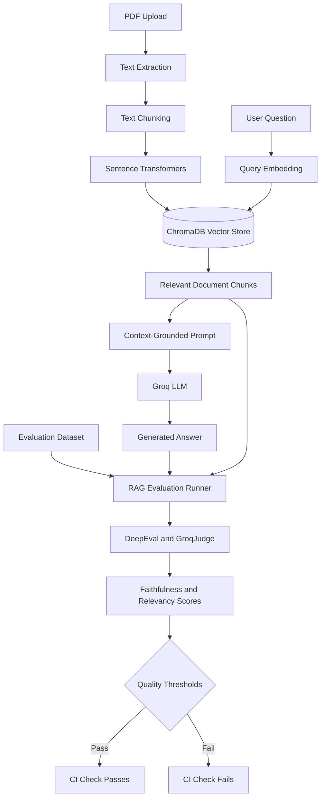

# NovaMind AI — Evaluated RAG PDF Assistant

NovaMind AI is an AI-powered Retrieval-Augmented Generation (RAG) application that allows users to upload PDF documents and interact with them conversationally using semantic search and large language models.

This project extends a document-question-answering application with an evaluation layer designed to measure response quality, assess grounding in retrieved context, and detect regressions through automated testing.

**Built with:** Python, Streamlit, LangChain, ChromaDB, Sentence Transformers, Groq API, DeepEval, and GitHub Actions.

## Key Features

- AI-powered PDF question answering
- Retrieval-Augmented Generation (RAG)
- Semantic search using vector embeddings
- Persistent vector storage with ChromaDB
- Groq-powered language model inference
- Context-grounded answer generation
- Automated RAG evaluation using DeepEval
- Custom `GroqJudge` integration for LLM-as-a-judge evaluation
- Faithfulness and answer-relevancy measurement
- Configurable evaluation thresholds for regression testing
- GitHub Actions workflow for automated checks
- Modern dark-themed interface with glassmorphism styling
- Interactive conversational experience

## Screenshots

### Application Interface


## Technology Stack

| Technology | Purpose |
|---|---|
| Python | Core application and evaluation logic |
| Streamlit | Interactive user interface |
| LangChain | LLM and retrieval workflow integration |
| Groq API | Language model inference |
| ChromaDB | Persistent vector database |
| Sentence Transformers | Semantic embedding generation |
| DeepEval | LLM and RAG evaluation |
| Custom GroqJudge | Connects a Groq model to the evaluation framework |
| GitHub Actions | Automated testing and evaluation workflow |

The evaluation judge is configured to use `openai/gpt-oss-120b`, subject to model availability and compatibility with the custom judge implementation.

## System Architecture



*The evaluation and CI/CD components should be retained in this diagram only to the extent that they are implemented and working in the repository.*

## How It Works

1. **Document ingestion:** PDF files are processed to extract text.
2. **Text chunking:** Extracted text is split into smaller passages for retrieval.
3. **Embedding generation:** Sentence Transformers converts passages into vector representations.
4. **Vector storage:** ChromaDB stores embeddings and associated document content.
5. **Semantic retrieval:** The user's question is embedded and relevant chunks are retrieved.
6. **Answer generation:** The question and retrieved context are passed to the Groq language model.
7. **Response evaluation:** DeepEval assesses generated responses against configured quality metrics.
8. **Regression testing:** GitHub Actions can run the evaluation suite and enforce configured thresholds on repository changes.

## RAG Evaluation with DeepEval

A RAG application should not only generate answers but also provide a way to evaluate whether those answers are relevant and supported by the retrieved documents.

NovaMind AI's evaluation layer uses DeepEval with a custom `GroqJudge` implementation.

### Evaluation Metrics

| Metric | Description |
|---|---|
| Faithfulness | Evaluates whether the answer's claims are supported by the retrieved context |
| Answer Relevancy | Evaluates whether the generated answer addresses the user's question |
| Contextual Relevancy | Evaluates how relevant the retrieved context is to the question, if configured |
| Answer Correctness | Evaluates agreement with reference answers, if configured |

### Evaluation Dataset

A reproducible evaluation dataset can contain:

- User questions
- Reference answers, where available
- Retrieved document context
- Generated answers
- Evaluation scores
- Pass/fail results

The dataset should include both answerable and unanswerable questions to test whether the application responds appropriately when the source documents do not contain sufficient evidence.

### Benchmark Results

Record results after running the evaluation suite on your actual dataset.

| Measurement | Result |
|---|---|
| Number of evaluation cases | To be measured |
| Faithfulness score | To be measured |
| Answer relevancy score | To be measured |
| Evaluation pass rate | To be measured |
| Average response latency | To be measured |

**Note:** No benchmark scores are claimed here. Replace these placeholders with measured results from your implementation.

## Continuous Integration and Regression Testing

GitHub Actions can automate testing and evaluation when changes are pushed or pull requests are opened.

The intended workflow includes:

1. Setting up Python and installing dependencies.
2. Running unit tests and other configured checks.
3. Executing the RAG evaluation dataset.
4. Calculating configured evaluation metrics.
5. Comparing results against defined quality thresholds.
6. Failing the workflow when required quality gates are not satisfied.

For reliable regression testing, use a stable evaluation dataset and document the model, configuration, and thresholds used for each benchmark.

A workflow that merely executes the evaluation script does not enforce quality gates unless the results are explicitly checked.

## Installation and Setup

### Prerequisites

- Python installed on your system
- Git
- A Groq API key
- Access to the required model and dependencies

### 1. Clone the Repository

```bash
git clone https://github.com/karan-singh-yadav/novamind-ai.git
cd novamind-ai
```

### 2. Create a Virtual Environment

**Windows**

```bash
python -m venv .venv
.venv\Scripts\activate
```

**macOS / Linux**

```bash
python3 -m venv .venv
source .venv/bin/activate
```

### 3. Install Dependencies

```bash
pip install -r requirements.txt
```

### 4. Configure Environment Variables

Create a `.env` file in the project root:

```env
GROQ_API_KEY=your_groq_api_key
```

If your evaluation implementation uses separate model configuration variables, add those according to the names expected by your code.

Get your API key from the [Groq Console](https://console.groq.com/keys).

**Security:** Never commit your `.env` file or expose API keys in source code.

### 5. Run the Application

```bash
streamlit run app.py
```

Open the local URL displayed in the terminal, usually:

`http://localhost:8501`

### 6. Run the Evaluation Suite

Use the actual evaluation command implemented in your repository. For example:

```bash
python evaluate.py
```

If your evaluation suite uses pytest, run:

```bash
pytest -q
```

These are examples; verify the filenames and commands against your project before using them.

## Reliability and Hallucination Reduction

The evaluation and grounding strategy is intended to help identify unsupported answers through:

- Supplying retrieved document context to the answer-generation model.
- Instructing the model to acknowledge insufficient evidence.
- Measuring faithfulness against retrieved context.
- Testing answer relevancy with a consistent evaluation dataset.
- Running regression checks after changes to prompts, retrieval settings, embeddings, or models.

Prompt instructions alone cannot guarantee hallucination-free answers. Reliable results also depend on retrieval quality, evidence verification, appropriate abstention behavior, and representative evaluation data.

## Future Improvements

- [ ] Add source citations and page-level references.
- [ ] Expand the evaluation dataset with difficult and unanswerable questions.
- [ ] Compare retrieval configurations and embedding models.
- [ ] Improve evaluation reporting and benchmark reproducibility.
- [ ] Add automated regression thresholds to GitHub Actions.
- [ ] Add Docker-based deployment.
- [ ] Introduce FastAPI endpoints for programmatic access.
- [ ] Add latency monitoring, structured logging, and error handling.
- [ ] Improve prompt-injection resistance and document access controls.

## Deployment

The application can potentially be deployed using:

- Streamlit Community Cloud
- Render
- Railway
- AWS or other cloud platforms

Deployment requires configuring secrets, dependencies, persistent storage, and any provider-specific settings.

## Why This Project?

NovaMind AI demonstrates practical work in:

- Retrieval-Augmented Generation
- Large language model integration
- Semantic search and vector databases
- Document processing and embeddings
- LLM evaluation and response-quality measurement
- Automated testing and CI/CD
- AI application development

The evaluation component extends the project beyond a basic document chatbot by introducing a measurable approach to RAG quality and regression testing.

## Author

**Karan Singh Yadav**

GitHub: [karan-singh-yadav](https://github.com/karan-singh-yadav)

---

If you find this project useful, consider giving the repository a star.

