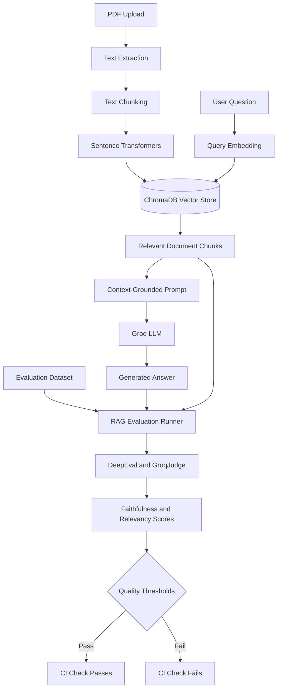

# NovaMind AI — Evaluated RAG PDF Assistant


NovaMind AI is a Retrieval-Augmented Generation (RAG) application that lets users upload PDF documents and ask questions about them using semantic search and large language models.

The project includes an automated evaluation layer that measures answer quality and grounding in retrieved context, and a CI pipeline that fails the build when quality drops below a threshold.

**Built with:** Python, Streamlit, LangChain, ChromaDB, Sentence Transformers, Groq API, DeepEval, and GitHub Actions.

## Key Features

- AI-powered PDF question answering
- Retrieval-Augmented Generation (RAG)
- Semantic search using vector embeddings
- Persistent vector storage with ChromaDB
- Groq-powered language model inference
- Context-grounded answers that admit when the document lacks the information
- Automated RAG evaluation using DeepEval
- Custom `GroqJudge` for LLM-as-a-judge evaluation
- Faithfulness and answer-relevancy measurement
- Configurable quality thresholds enforced in CI
- GitHub Actions workflow that blocks regressions
- Modern dark-themed interface with glassmorphism styling

## Screenshots


<!-- PASTE YOUR EXISTING SCREENSHOTS SECTION HERE -->

## Technology Stack

| Technology            | Purpose                                           |
| --------------------- | ------------------------------------------------- |
| Python                | Core application and evaluation logic             |
| Streamlit             | Interactive user interface                        |
| LangChain             | LLM and retrieval workflow integration            |
| Groq API              | Language model inference                          |
| ChromaDB              | Persistent vector database                        |
| Sentence Transformers | Semantic embedding generation (`all-MiniLM-L6-v2`) |
| DeepEval              | LLM and RAG evaluation                            |
| Custom GroqJudge      | Connects a Groq model to the evaluation framework |
| GitHub Actions        | Automated testing and evaluation workflow         |

Both answer generation and the evaluation judge use `openai/gpt-oss-120b` on Groq Cloud. The model can be changed with the `GROQ_MODEL` environment variable.

## System Architecture



## How It Works

1. **Document ingestion:** PDF files are processed to extract text.
2. **Text chunking:** Extracted text is split into overlapping passages (1000 characters, 200 overlap).
3. **Embedding generation:** Sentence Transformers converts passages into vectors.
4. **Vector storage:** ChromaDB stores embeddings and document content.
5. **Semantic retrieval:** The question is embedded and the top matching chunks are retrieved.
6. **Answer generation:** The question and retrieved context are sent to the Groq model, which is instructed to answer only from the context.
7. **Response evaluation:** DeepEval scores answers with Faithfulness and Answer Relevancy.
8. **Regression testing:** GitHub Actions runs the evaluation suite on every push and pull request.

## RAG Evaluation with DeepEval

The evaluation layer uses DeepEval with a custom `GroqJudge` (`src/eval/eval_judge.py`), a `DeepEvalBaseLLM` subclass that calls Groq, handles rate limits with retries, and extracts clean JSON from model output.

### Evaluation Metrics

| Metric           | Description                                                                  |
| ---------------- | ---------------------------------------------------------------------------- |
| Faithfulness     | Whether the answer's claims are supported by the retrieved context           |
| Answer Relevancy | Whether the generated answer addresses the user's question                   |

### Evaluation Dataset

The dataset is in `tests/eval_dataset.json`. Each case contains a question and a reference answer based on the source PDF (`machine_learning_tutorial.pdf`). Retrieved context and generated answers are produced at test time.

### Benchmark Results

| Measurement                | Result                             |
| -------------------------- | ---------------------------------- |
| Number of evaluation cases | 3                                  |
| Metrics                    | Faithfulness, Answer Relevancy     |
| Threshold (each metric)    | 0.6                                |
| Generator and judge model  | `openai/gpt-oss-120b` (Groq Cloud) |
| Evaluation pass rate       | 3/3 in the latest CI run           |

The dataset is small, so these results are a regression baseline rather than a full benchmark. Expanding it with more answerable and unanswerable questions is planned.

## Continuous Integration

The workflow in `.github/workflows/eval_ci.yml` runs on every push and pull request to `main`:

1. Set up Python 3.11 and install dependencies.
2. Build the vector store from the PDF (the local `chroma_db/` is not committed, so CI creates it).
3. Retrieve context and generate answers for each case in the dataset.
4. Score each answer with Faithfulness and Answer Relevancy using `GroqJudge`.
5. Fail the build if any case scores below the 0.6 threshold.

This requires a `GROQ_API_KEY` repository secret (Settings → Secrets and variables → Actions).

## Installation and Setup

### Prerequisites

- Python 3.11
- Git
- A Groq API key

### 1. Clone the Repository

```bash
git clone https://github.com/karan-singh-yadav/novamind-ai.git
cd novamind-ai
```

### 2. Create a Virtual Environment

**Windows**

```bash
python -m venv .venv
.venv\Scripts\activate
```

**macOS / Linux**

```bash
python3 -m venv .venv
source .venv/bin/activate
```

### 3. Install Dependencies

```bash
pip install -r requirements.txt
```

### 4. Configure Environment Variables

Create a `.env` file in the project root:

```
GROQ_API_KEY=your_groq_api_key
# Optional: override the default model
# GROQ_MODEL=openai/gpt-oss-120b
```

Get your API key from the [Groq Console](https://console.groq.com/keys).

**Security:** Never commit your `.env` file or expose API keys in source code.

### 5. Run the Application

```bash
streamlit run app.py
```

Open `http://localhost:8501` in your browser.

### 6. Run the Evaluation Suite

```bash
pytest tests/test_rag_eval.py -v
```

The test builds the vector store from `machine_learning_tutorial.pdf`, retrieves context for each question in `tests/eval_dataset.json`, generates answers, and scores them with DeepEval. A case passes only if both Faithfulness and Answer Relevancy are at or above 0.6.

## Project Structure

```
novamind-ai/
├── app.py                      # Streamlit application
├── benchmark_chunks.py         # Chunking benchmark script
├── machine_learning_tutorial.pdf
├── requirements.txt
├── src/
│   ├── ingestion/              # PDF loading, chunking, embeddings
│   ├── retrieval/              # ChromaDB vector store and retriever
│   ├── llm/                    # Groq answer generation
│   └── eval/                   # Custom GroqJudge for DeepEval
├── tests/
│   ├── eval_dataset.json       # Evaluation questions and references
│   └── test_rag_eval.py        # DeepEval regression test
└── .github/workflows/
    └── eval_ci.yml             # CI evaluation pipeline
```

## Reliability and Hallucination Reduction

- Retrieved document context is supplied to the answer-generation model.
- The prompt tells the model to say so when the context does not contain the answer.
- Faithfulness is measured against retrieved context.
- Answer relevancy is tested on a fixed evaluation dataset.
- CI re-runs the checks after changes to prompts, retrieval settings, embeddings, or models.

Prompt instructions alone cannot guarantee hallucination-free answers. Reliable results also depend on retrieval quality and representative evaluation data.

## Future Improvements

- [x] Add automated regression thresholds to GitHub Actions.
- [ ] Add source citations and page-level references.
- [ ] Expand the evaluation dataset, including unanswerable questions.
- [ ] Compare retrieval configurations and embedding models.
- [ ] Report average metric scores and latency per run.
- [ ] Add Docker-based deployment.
- [ ] Introduce FastAPI endpoints for programmatic access.
- [ ] Add latency monitoring and structured logging.
- [ ] Improve prompt-injection resistance and document access controls.

## Deployment

The application can be deployed on Streamlit Community Cloud, Render, Railway, or AWS. Deployment requires configuring secrets, dependencies, and persistent storage.

## Author

**Karan Singh Yadav**

GitHub: [karan-singh-yadav](https://github.com/karan-singh-yadav)

---

If you find this project useful, consider giving the repository a star.
